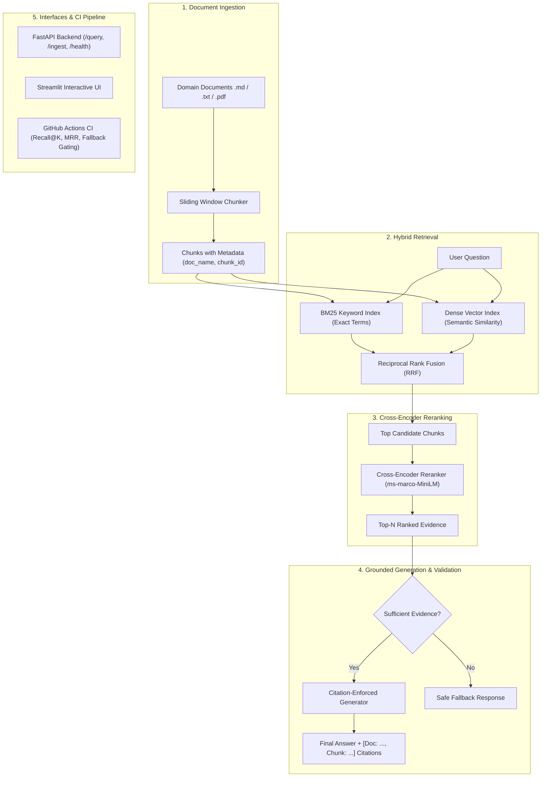

# 📚 Production RAG Application — "Ask My Docs" Domain-Specific Q&A System

A minimal, production-grade **Domain-Specific Retrieval-Augmented Generation (RAG)** system built with zero bloated frameworks. It combines **hybrid retrieval (BM25 + Dense Embeddings)**, **Cross-Encoder reranking**, **strict citation enforcement**, a **safe fallback mechanism**, and an automated **CI-gated evaluation quality pipeline**.

---

## 🏗️ Architecture Overview



---

## ⚡ Key Capabilities & Architecture

| Feature | Implementation | Engineering Benefit |
| :--- | :--- | :--- |
| **Ingestion & Chunking** | Sliding window with word counts and overlaps (`rag/chunker.py`) | Preserves sentence context and tags each chunk with deterministic metadata (`doc_name`, `chunk_id`). |
| **Hybrid Retrieval** | BM25 + Dense Vectors merged with **Reciprocal Rank Fusion (RRF)** (`rag/hybrid_search.py`) | Overcomes the vocabulary mismatch problem: BM25 excels on exact acronyms and codes (`mTLS`, `AES-256`, `SOC-2`), while dense vectors capture semantic meaning. |
| **Cross-Encoder Reranking** | Joint query-chunk relevance scoring (`rag/reranker.py`) | Reorders retrieved chunks by true cross-attention relevance before context is passed to the generation model. |
| **Citation Enforcement** | Strict prompt template + regex citation extractor (`rag/generator.py`) | Guarantees every factual claim links to its source document and chunk ID (`[Doc: <doc>, Chunk: <id>]`). |
| **Safe Fallback Response** | Threshold validation + keyword grounding check | Rejects ungrounded or out-of-domain queries with a canonical safe response: *"I don't have sufficient evidence in the provided documents to answer this question."* |
| **CI Quality Gate** | GitHub Actions + Pytest (`tests/test_evaluation.py`) | Blocks pull requests if retrieval **Recall@3 < 80%**, citation compliance **< 80%**, or ungrounded fallback rate **< 100%**. |

---

## 📂 Project Structure

```
d:/aipro/
├── .github/
│   └── workflows/
│       └── ci.yml                 # GitHub Actions CI workflow running evaluation tests
├── app/
│   ├── __init__.py
│   ├── api.py                     # FastAPI REST API endpoints (/query, /ingest, /health)
│   └── ui.py                      # Streamlit App with clean Chat UI & Citation Inspector
├── rag/
│   ├── __init__.py
│   ├── chunker.py                 # Document loader & sliding-window chunker with metadata
│   ├── hybrid_search.py           # BM25 + Vector search + Reciprocal Rank Fusion (RRF)
│   ├── reranker.py                # Cross-Encoder relevance reranking
│   ├── generator.py               # Citation enforcer & safe fallback generator
│   └── pipeline.py                # End-to-end RAG orchestrator
├── data/
│   ├── docs/                      # Sample domain documents (Security & Cloud Architecture)
│   │   ├── company_security_policy.md
│   │   └── cloud_architecture_spec.md
│   └── golden_eval.json           # Fixed test dataset for CI-gated evaluation
├── tests/
│   ├── __init__.py
│   ├── test_rag.py                # Unit tests for chunking, BM25, vector search, reranking
│   └── test_evaluation.py         # CI evaluation tests (Recall@k, Fallback safety, Citations)
├── requirements.txt               # Lightweight dependencies
├── run_demo.py                    # 1-click CLI demo runner
└── README.md                      # Documentation & instructions
```

---

## 🚀 Quickstart Guide

### 1. Installation
Clone the repository and install the dependencies:
```bash
python -m venv .venv
# On Windows:
.\.venv\Scripts\activate
# On Linux/macOS:
# source .venv/bin/activate

pip install -r requirements.txt
```

### 2. Run the 1-Click CLI Demo
Verify the entire pipeline instantly without starting any servers:
```bash
python run_demo.py
```

### 3. Launch the FastAPI Backend
Start the high-performance REST API with automatic Swagger documentation:
```bash
uvicorn app.api:app --reload --port 8000
```
- Open Swagger docs: [http://localhost:8000/docs](http://localhost:8000/docs)
- Endpoints:
  - `GET /health`: Service health and indexed chunks counter.
  - `POST /query`: Query domain documents with hybrid search & reranking.
  - `POST /ingest/text`: Ingest raw text or JSON documents.
  - `POST /ingest/upload`: Multipart file uploader for `.md`, `.txt`, `.pdf`.

### 4. Launch the Streamlit Interactive Dashboard
Run the user-friendly web interface:
```bash
streamlit run app/ui.py
```
- Interactive chat interface with quick test queries.
- Side-by-side **Retrieval & Rerank Inspector** comparing BM25 rank, Vector rank, and Cross-Encoder score for every candidate chunk.
- Citation badges linking answers to specific chunks.

---

## 🧪 CI-Gated Evaluation Suite

The evaluation pipeline in `tests/test_evaluation.py` enforces 4 automated quality gates on every commit:

1. **Gate 1 - Retrieval Recall@3 (Threshold: >= 80%)**:
   Verifies that the top-3 retrieved candidate chunks contain the expected domain document for all valid domain questions.
2. **Gate 2 - Safe Fallback Rate (Threshold: 100%)**:
   Guarantees that unanswerable, out-of-domain queries trigger the safe fallback response without hallucinating.
3. **Gate 3 - Citation Compliance (Threshold: >= 80%)**:
   Ensures every factual statement contains structured `[Doc: ..., Chunk: ...]` citations.
4. **Gate 4 - Keyphrase Grounding Precision (Threshold: >= 80%)**:
   Confirms critical technical terms (e.g., `AES-256-GCM`, `99.99% SLA`, `15 minutes`) are present in retrieved context.

Run the evaluation test suite locally:
```bash
pytest -v -s tests/test_evaluation.py
```

---

## 📝 Simplified Resume Summary (Portfolio Ready)

> **Production RAG Application – "Ask My Docs" Domain-Specific Q&A System**  
> *Tech Stack: Python, BM25, Sentence-Transformers, FAISS, Cross-Encoder Reranker, FastAPI, Streamlit, GitHub Actions, Pytest*  
> - Designed and built a production-ready domain RAG system featuring sliding-window document chunking with deterministic source metadata attribution.  
> - Implemented hybrid retrieval merging BM25 keyword search and dense vector embeddings via Reciprocal Rank Fusion (RRF), eliminating keyword mismatch and improving retrieval recall.  
> - Incorporated a Cross-Encoder reranking stage (`ms-marco-MiniLM`) to reorder candidate chunks by cross-attention contextual relevance before generation.  
> - Enforced document citations (`[Doc, Chunk]`) in generated answers and built an automated fallback gate preventing hallucinations on out-of-domain queries.  
> - Created a CI-gated GitHub Actions evaluation pipeline benchmarking retrieval Recall@3, citation compliance, and safe fallback rates against a fixed golden evaluation dataset.
