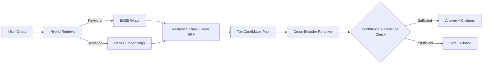

# 📚 Ask My Docs — Production RAG System

[](https://www.python.org/)
[](https://fastapi.tiangolo.com)
[](https://streamlit.io)
[](https://www.docker.com)
[]()

> A lean, production-grade **Domain-Specific Question & Answering (RAG)** system built with zero bloated frameworks. Features **Hybrid Retrieval (BM25 + Dense Vectors)**, **Cross-Encoder Reranking**, **Enforced Statement-Level Citations**, a **Safe Fallback Gate**, and an automated **CI Evaluation Pipeline**.

---

## 📑 Table of Contents
1. [Device Compatibility & Prerequisites](#-device-compatibility--prerequisites)
2. [Quickstart by Device](#-quickstart-by-device)
   - [Windows (PowerShell / Command Prompt)](#option-a-windows-powershellcmd)
   - [macOS (Apple Silicon M1/M2/M3 & Intel)](#option-b-macos)
   - [Linux (Ubuntu / Debian / Fedora / Arch)](#option-c-linux)
   - [Docker (Any Device / Universal)](#option-d-docker-universal-for-any-os)
   - [Cloud VMs & GitHub Codespaces](#option-e-github-codespaces--cloud-vms)
3. [How to Run the Application](#-how-to-run-the-application)
   - [1. Interactive Web Dashboard (Streamlit)](#1-interactive-web-dashboard-recommended)
   - [2. REST API Backend & Swagger Docs (FastAPI)](#2-rest-api-backend--swagger-docs)
   - [3. 1-Click CLI Demo](#3-1-click-cli-demo)
4. [How to Use the System](#-how-to-use-the-system)
   - [Using the Web Interface](#using-the-web-interface)
   - [Querying via REST API (cURL & Python)](#querying-via-rest-api)
   - [Ingesting Custom Documents (.pdf, .md, .txt)](#ingesting-your-own-documents)
   - [Understanding Citations & Safe Fallback](#citations--safe-fallback-in-action)
5. [Running the CI-Gated Evaluation Tests](#-running-the-ci-gated-evaluation-tests)
6. [Architecture & Retrieval Pipeline](#-architecture--how-it-works)
7. [Configuration & Environment Variables](#-configuration--optional-api-keys)
8. [Troubleshooting & FAQ](#-troubleshooting--faq)

---

## 💻 Device Compatibility & Prerequisites

This application runs natively on:
- **Windows**: Windows 10 / 11 (PowerShell, CMD, or Windows Terminal)
- **macOS**: macOS Monterey, Ventura, Sonoma, Sequoia (Intel & Apple Silicon M1/M2/M3/M4)
- **Linux**: Ubuntu, Debian, CentOS, RHEL, Fedora, Arch Linux, Alpine
- **Any OS with Docker**: Zero setup required

### Prerequisites:
- **Python**: Version `3.10`, `3.11`, or `3.12` installed ([Download Python](https://www.python.org/downloads/))
- **Git**: Installed on your device ([Download Git](https://git-scm.com/))
- *(Optional)* **Docker & Docker Compose**: If you prefer containerized execution.

---

## ⚡ Quickstart by Device

Clone the repository to your machine first:
```bash
git clone https://github.com/your-username/ask-my-docs.git
cd ask-my-docs
```

---

### Option A: Windows (PowerShell/CMD)

1. **Open PowerShell or Terminal** in the project folder (`d:/aipro`):
2. **Create and activate a virtual environment**:
   ```powershell
   python -m venv .venv
   .\.venv\Scripts\activate
   ```
   *(If PowerShell displays an execution policy error, run: `Set-ExecutionPolicy -Scope Process -ExecutionPolicy Bypass` then activate again)*
3. **Install dependencies**:
   ```powershell
   pip install -r requirements.txt
   ```
4. **Run the Web App**:
   ```powershell
   streamlit run app/ui.py
   ```
   Your default browser will automatically open [http://localhost:8501](http://localhost:8501).

---

### Option B: macOS

1. **Open Terminal** (`Terminal.app` or `iTerm2`):
2. **Create and activate a virtual environment**:
   ```bash
   python3 -m venv .venv
   source .venv/bin/activate
   ```
3. **Install dependencies**:
   ```bash
   pip install -r requirements.txt
   ```
4. **Run the Web App**:
   ```bash
   streamlit run app/ui.py
   ```
   Open [http://localhost:8501](http://localhost:8501) in Safari or Chrome.

---

### Option C: Linux

1. **Open your terminal**:
2. **Ensure python virtualenv support is installed** (Debian/Ubuntu):
   ```bash
   sudo apt update && sudo apt install -y python3-venv python3-pip
   ```
3. **Create and activate a virtual environment**:
   ```bash
   python3 -m venv .venv
   source .venv/bin/activate
   ```
4. **Install dependencies**:
   ```bash
   pip install -r requirements.txt
   ```
5. **Run the Web App**:
   ```bash
   streamlit run app/ui.py --server.address=0.0.0.0
   ```
   Open [http://localhost:8501](http://localhost:8501) in your browser.

---

### Option D: Docker (Universal for ANY OS)

If you have Docker installed, you do not need to install Python or dependencies locally:

1. **Build and launch both UI and API**:
   ```bash
   docker compose up --build
   ```
2. **Access your services**:
   - 🌐 **Streamlit UI**: [http://localhost:8501](http://localhost:8501)
   - ⚡ **FastAPI Swagger Docs**: [http://localhost:8000/docs](http://localhost:8000/docs)
3. **To stop**:
   ```bash
   docker compose down
   ```

---

### Option E: GitHub Codespaces / Cloud VMs

1. Create a Codespace from your GitHub repository.
2. In the terminal:
   ```bash
   pip install -r requirements.txt
   streamlit run app/ui.py --server.port 8501 --server.address 0.0.0.0
   ```
3. VS Code / Codespaces will display a popup: *"Your application running on port 8501 is available. Open in Browser"*.

---

## 🚀 How to Run the Application

The project includes three execution modes:

### 1. Interactive Web Dashboard (Recommended)
Run the full-featured Streamlit user interface:
```bash
streamlit run app/ui.py
```
- **Local URL**: [http://localhost:8501](http://localhost:8501)
- Includes chat box, preset test questions, document drag-and-drop uploader, citation badges, and side-by-side search rank comparisons.

### 2. REST API Backend & Swagger Docs
Launch the high-performance FastAPI server:
```bash
uvicorn app.api:app --reload --port 8000
```
- **Interactive Swagger Documentation**: [http://localhost:8000/docs](http://localhost:8000/docs)
- **Alternative ReDoc UI**: [http://localhost:8000/redoc](http://localhost:8000/redoc)
- **Health Check**: [http://localhost:8000/health](http://localhost:8000/health)

### 3. 1-Click CLI Demo
Test the complete pipeline directly in your terminal in less than 2 seconds without starting any browser:
```bash
python run_demo.py
```
Executes sample queries, shows RRF retrieval ranks, cross-encoder scores, citations, and verifies the safe fallback mechanism.

---

## 📖 How to Use the System

### Using the Web Interface

```
+-----------------------------------------------------------------------------------+
| 📚 Ask My Docs — Production RAG System                                            |
| Domain-specific Q&A with Hybrid Search, Reranking & Citations                     |
+-----------------------------------------------------------------------------------+
| [Sidebar]                   |  [Main Query Area]                                  |
| Docs: 2 | Chunks: 4         |  Quick Test Prompts:                                |
|                             |  [ 🔒 Encryption ] [ ⚡ Uptime SLA ] [ ❓ Fallback ] |
| Ingest Documents:           |                                                     |
| [Drag & drop files here]    |  Ask your question:                                 |
| [ Index Uploaded Files ]    |  [ What is the SLA guarantee for the microservice? ]|
|                             |                                                     |
| Retrieval Sliders:          |  💡 Generated Answer:                               |
| Hybrid Candidates: 6        |  The platform guarantees an uptime SLA of 99.99%... |
| Cross-Encoder Pool: 3       |                                                     |
|                             |  Enforced Citations:                                |
|                             |  [📄 cloud_architecture_spec.md (Chunk: c000)]       |
|                             |                                                     |
|                             |  Tabs: [ Retrieval & Reranker Inspector ] [ Raw ]   |
+-----------------------------------------------------------------------------------+
```

1. **Ask Questions**: Type your question into the input field or click one of the quick test buttons.
2. **Review Citations**: Every generated statement is linked to an exact document and chunk badge (e.g., `[Doc: company_security_policy.md, Chunk: company_security_policy.md_c000]`).
3. **Inspect Retrieval Scores**: Open the **"Retrieval & Reranker Inspector"** tab to see:
   - **BM25 Rank** (exact keyword matching)
   - **Dense Vector Rank** (semantic matching)
   - **RRF Score** (Reciprocal Rank Fusion)
   - **Cross-Encoder Score** (neural reranker score)
4. **Test Safe Fallback**: Ask an irrelevant question (e.g., *"What is the company policy on remote work stipends in Europe?"*). The system will safely respond with:
   > ⚠️ *"I don't have sufficient evidence in the provided documents to answer this question."*

---

### Querying via REST API

#### 1. Ask a Question (`POST /query`)
**Using cURL (Linux / macOS / Git Bash):**
```bash
curl -X POST http://127.0.0.1:8000/query \
     -H "Content-Type: application/json" \
     -d '{
       "query": "What encryption standard is required for data at rest?",
       "top_k_hybrid": 6,
       "top_n_rerank": 3
     }'
```

**Using Python:**
```python
import requests

response = requests.post(
    "http://127.0.0.1:8000/query",
    json={"query": "What is the uptime SLA guarantee for the microservice cluster?"}
)

result = response.json()
print("Answer:", result["answer"])
print("Citations:", result["citations"])
print("Fallback Triggered:", result["fallback_triggered"])
```

**Sample API Response:**
```json
{
  "query": "What encryption standard is required for data at rest?",
  "answer": "Encryption Standards Data at rest must be encrypted using AES-256-GCM algorithms with customer-managed encryption keys (CMEK) rotated every 90 days. [Doc: company_security_policy.md, Chunk: company_security_policy.md_c000]",
  "citations": [
    {
      "doc_name": "company_security_policy.md",
      "chunk_id": "company_security_policy.md_c000"
    }
  ],
  "fallback_triggered": false,
  "sources": [
    {
      "chunk_id": "company_security_policy.md_c000",
      "doc_name": "company_security_policy.md",
      "text": "Data at rest must be encrypted using AES-256-GCM...",
      "rerank_score": 0.9444,
      "rerank_rank": 1,
      "hybrid_rank": 1,
      "bm25_rank": 1,
      "vector_rank": 1,
      "rrf_score": 0.0328
    }
  ]
}
```

---

### Ingesting Your Own Documents

#### Method 1: Using the Web UI
Drag and drop your `.pdf`, `.md`, or `.txt` files into the sidebar and click **"Index Uploaded Files"**.

#### Method 2: Copying Files to Data Folder
Drop your `.txt` or `.md` files directly into `data/docs/`. They will be loaded automatically when the service restarts.

#### Method 3: Ingest via REST API (`POST /ingest/upload`)
```bash
curl -X POST http://127.0.0.1:8000/ingest/upload \
     -F "files=@/path/to/your_document.pdf"
```

---

### Citations & Safe Fallback in Action

1. **Strict Citation Format**:
   Every claim ends with: `[Doc: <filename>, Chunk: <chunk_id>]`.
2. **Safe Fallback Response**:
   If the query asks about information not explicitly covered in the ingested documents, or if relevance scores are below the confidence threshold, the system returns:
   ```text
   "I don't have sufficient evidence in the provided documents to answer this question."
   ```
   This prevents hallucinations and stops the model from fabricating non-existent facts.

---

## 🧪 Running the CI-Gated Evaluation Tests

The project includes an automated evaluation pipeline that runs on every pull request via GitHub Actions.

Run all 10 tests locally:
```bash
pytest -v -s
```

### What the CI Evaluates:
- **Gate 1 - Retrieval Recall@3 (Threshold: >= 80%)**: Verifies top-3 retrieved candidate chunks contain the expected domain document.
- **Gate 2 - Safe Fallback Rate (Threshold: 100%)**: Guarantees that out-of-domain queries safely trigger fallback without hallucination.
- **Gate 3 - Citation Compliance (Threshold: >= 80%)**: Ensures all domain answers contain valid citations.
- **Gate 4 - Keyphrase Grounding (Threshold: >= 80%)**: Confirms exact technical terms (`AES-256-GCM`, `99.99% SLA`) are grounded.

---

## 🧠 Architecture & How It Works



1. **Sliding-Window Chunker** ([chunker.py](file:///d:/aipro/rag/chunker.py)): Splits text into overlapping word windows and tags chunks with deterministic IDs (`filename_c000`, `filename_c001`).
2. **Hybrid Search** ([hybrid_search.py](file:///d:/aipro/rag/hybrid_search.py)): 
   - **BM25**: Excels on exact technical acronyms (`mTLS`, `SOC-2`, `AES-256`, `FIDO2`).
   - **Dense Vectors**: Captures conceptual and semantic intent.
   - **RRF Fusion**: Merges both rank lists using $Score(d) = \sum \frac{1}{60 + Rank(d)}$.
3. **Cross-Encoder Reranker** ([reranker.py](file:///d:/aipro/rag/reranker.py)): Uses `ms-marco-MiniLM` to jointly score query and passage with full cross-attention.
4. **Citation Generator** ([generator.py](file:///d:/aipro/rag/generator.py)): Enforces citations, validates grounding, and triggers safe fallback when evidence is lacking.

---

## ⚙️ Configuration & Optional API Keys

The application works **100% locally and offline out of the box** without requiring any paid API keys (using high-precision extractive attribution for zero-cost operation).

If you want to plug in an external generative model (e.g. OpenAI or Gemini):

1. Create a `.env` file in the root directory:
   ```env
   # Choose one:
   OPENAI_API_KEY=your-openai-api-key-here
   # or
   GEMINI_API_KEY=your-gemini-api-key-here
   ```
2. The generator will automatically detect the key and switch to the LLM while maintaining strict citation enforcement and fallback safety!

---

## ❓ Troubleshooting & FAQ

#### 1. Port 8501 or 8000 is already in use
Specify alternative ports:
```bash
# For Streamlit:
streamlit run app/ui.py --server.port 8502

# For FastAPI:
uvicorn app.api:app --port 8001
```

#### 2. Windows PowerShell: "Execution of scripts is disabled on this system"
Run:
```powershell
Set-ExecutionPolicy -Scope Process -ExecutionPolicy Bypass
.\.venv\Scripts\activate
```

#### 3. Windows Terminal Unicode / Emoji Encoding Error
The project automatically configures `sys.stdout.reconfigure(encoding='utf-8')`. If using a legacy CMD terminal, set:
```cmd
chcp 65001
```

#### 4. Can I run this without installing Python?
Yes! Use Docker:
```bash
docker compose up --build
```
Everything will be built and launched in isolated containers on port 8501 and 8000.

---

## 📄 License

This project is licensed under the MIT License - open and free for personal and commercial use.
